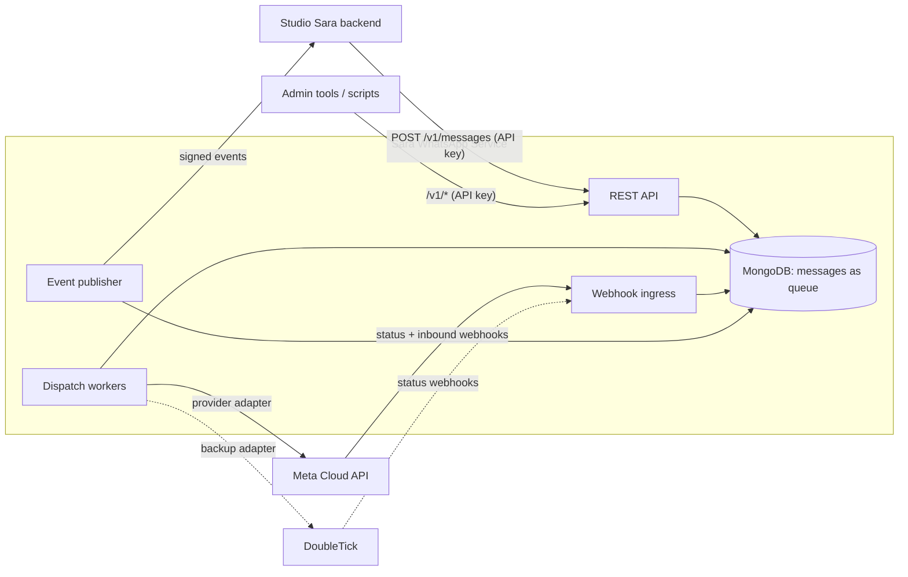
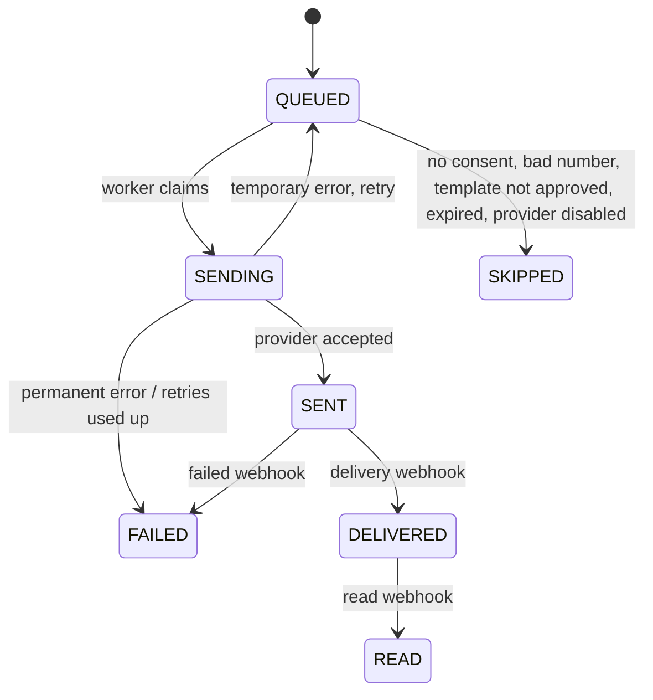

# Sara WhatsApp Service — Architecture

Status: draft for review. Nothing here is built yet.
Source of requirements: *Studio Sara — WhatsApp on Meta Cloud API* proposal (Elyvate Labs, 25 Oct 2026).

## 1. Purpose

A standalone, API-only, **template-driven** WhatsApp service. It sends WhatsApp messages through Meta's WhatsApp Cloud API, in place of DoubleTick. Clients (Studio Sara's backend first) call it over HTTP. It has no UI.

The service does not know what kinds of messages a client sends. It has no built-in list of messages such as "OTP" or "order update". A client defines any number of templates, with any parameters, and sends messages by naming a template. Which templates exist, what they say and when the client sends them is the client's data, not the service's code.

WhatsApp allows a business to start a conversation only with a Meta-approved **template message**. An OTP, an order update and an offer are therefore not different kinds of sending. They are templates, and Meta gives each template a category (authentication, utility or marketing). The service has two sending paths, and both produce the same message records:

1. **Messaging.** One template message to one recipient, normally triggered by an event in the client's application. This covers every automatic message in the proposal, including authentication (OTP) messages and documents (a template with a document header).
2. **Broadcast.** One template to many opted-in recipients, paced and consent-checked. This covers broadcast campaigns and collection launches.

What the proposal's 16 features become, as generic capabilities:


| Domain    | Capability                             | What it covers from the proposal                                                                       |
| --------- | -------------------------------------- | ------------------------------------------------------------------------------------------------------ |
| Messaging | Send a template message (any category) | All automatic customer messages, including OTP, and documents on WhatsApp                              |
| Messaging | Template manager                       | Create, list and sync Meta templates and their approval status                                         |
| Messaging | Event mapping                          | A client maps its own event names to templates and can change the template later without a code change |
| Messaging | Message log and delivery status        | Sent, failed and skipped log with reasons, plus sent, delivered, read and failed from Meta             |
| Broadcast | Campaigns and collection launches      | One template to many opted-in contacts, with schedule, progress and cancel                             |
| Control   | Provider switch                        | Meta or DoubleTick, changed by configuration                                                           |
| Control   | Spend                                  | Estimated monthly cost, and a link to Meta's billing page                                              |


Not in scope: a DoubleTick-style chat inbox (the proposal leaves that to the Studio Sara portal), a UI, and multi-vendor tenancy.

## 2. Decisions


| Topic                         | Decision                                                                              |
| ----------------------------- | ------------------------------------------------------------------------------------- |
| Stack                         | Java 21, Spring Boot 3 (same as `sara-backend-ecom` and `sara-notification-service`)  |
| Interface                     | REST API only, versioned under `/v1`                                                  |
| Tenancy                       | One deployed instance = one Meta account. See section 4, principle 2                  |
| Messages                      | Fully template-driven. Nothing about specific message types is built into the service |
| Sending                       | Database-backed queue with background workers                                         |
| Database                      | MongoDB cluster (online, managed)                                                     |
| Delivery status to the client | Signed outbound webhook events plus a query API                                       |
| Providers                     | Meta Cloud API (main), DoubleTick (switchable backup)                                 |
| Deploy                        | Jenkins and pm2, with secrets from Doppler, like the other services                   |


## 3. System context




Message path: the caller gets a `202` and a message id as soon as the message is queued. A worker sends it to Meta later. Meta reports sent, delivered, read or failed through a webhook. The service updates the message and posts a signed event to the caller.

## 4. Design principles

These are the common practices used by messaging platforms, and how each applies here.

1. **API-first.** Every capability in the proposal is an endpoint. Any later UI is just another client.
2. **One account per instance, with a clean seam.** Meta credentials and settings are read through a single `AccountConfig` class and nowhere else. No tenant tables now. If vendors are added later, that class becomes tenant-aware.
3. **Generic by data, not by code.** Templates, parameters, event names and bindings are stored data. A new kind of message needs no deploy.
4. **Accept fast, send later.** The API only validates and queues. Sending happens in workers, so a slow Meta response never blocks a caller.
5. **At-least-once delivery with idempotency.** Callers send a `clientMessageId`. The same id never creates two messages (unique index). Workers claim a message atomically before sending.
6. **Explicit message state machine.** Status only moves forward (section 8). A late "delivered" never overwrites "read".
7. **Provider adapter.** The core code knows only a `WhatsAppProvider` interface. Meta and DoubleTick are two implementations. Switching is a config change.
8. **Priority lanes.** The caller chooses a lane per message (`HIGH` or `NORMAL`, default `NORMAL`). Broadcast messages always use the `BULK` lane, so a broadcast never delays a message in another lane.
9. **Optional expiry.** A caller can set `expiresAt` on any message. If it cannot be sent in time it is marked `SKIPPED (EXPIRED)` instead of arriving late. The service does not decide which messages are time-sensitive.
10. **Back-pressure and rate limits.** Workers send at a configurable rate per Meta phone number. Broadcasts are sent in small chunks.
11. **Verify everything inbound, sign everything outbound.** Meta webhooks are verified with `X-Hub-Signature-256`. Events to clients are signed with HMAC-SHA256.
12. **Least privilege.** API keys have scopes (send, read, templates, broadcast, admin). Keys are stored hashed.
13. **Secrets encrypted at rest.** Meta token and app secret are stored AES-GCM encrypted, with a master key from the environment (the same pattern as Runtime Config in Studio Sara).
14. **Consent for marketing.** Broadcasts go only to contacts with recorded opt-in. Opt-outs are honoured immediately.
15. **No sensitive data in logs.** Phone numbers are masked in logs. Message parameters and tokens are never logged.
16. **Observable.** Structured logs with a correlation id, metrics for queue depth and age, send latency and failure rate.
17. **Fail safe.** A provider outage queues and retries. A permanent error fails fast with a clear reason. Nothing is dropped silently.


## 5. Components

The components fall into the two sending domains (Messaging and Broadcast), plus the parts they share (provider adapters, queue, webhooks, usage, config).


| Component             | Responsibility                                                                                                 |
| --------------------- | -------------------------------------------------------------------------------------------------------------- |
| **API layer**         | Auth (API key), validation, idempotency, error format, pagination                                              |
| **Message service**   | Creates messages, applies template rules, checks consent and number format, exposes the log                    |
| **Template service**  | Lists, creates and syncs Meta templates; keeps the mapping from app events to templates                        |
| **Broadcast service** | Builds an audience, creates one message per recipient in chunks, tracks progress, supports schedule and cancel |
| **Contact service**   | Stores consent (opt-in/opt-out) and basic contact info                                                         |
| **Dispatch workers**  | Claim queued messages, call the active provider, schedule retries                                              |
| **Provider adapters** | `MetaCloudProvider` and `DoubleTickProvider` behind one interface                                              |
| **Webhook ingress**   | Receives and verifies Meta (and DoubleTick) status callbacks, updates messages                                 |
| **Event publisher**   | Sends signed events to each client's callback URL, with retries                                                |
| **Usage service**     | Counts messages by category and estimates monthly spend from a configurable rate table                         |
| **Config service**    | Active provider, Meta credentials (encrypted), rates, limits                                                   |


## 6. Data model (MongoDB)

All timestamps are UTC. Phone numbers are stored in E.164 form.


| Collection        | Purpose                                                                         | Main fields                                                                                                                                                                                                                                                                                                                                                                                                                          | Indexes                                                                                                                                  |
| ----------------- | ------------------------------------------------------------------------------- | ------------------------------------------------------------------------------------------------------------------------------------------------------------------------------------------------------------------------------------------------------------------------------------------------------------------------------------------------------------------------------------------------------------------------------------ | ---------------------------------------------------------------------------------------------------------------------------------------- |
| `messages`        | The message log and the queue                                                   | `_id`, `clientId`, `clientMessageId`, `event` (optional, name chosen by the caller), `templateKey`, `category` (copied from the template), `to`, `recipientCountry`, `parameters` (header, body and button values), `priority`, `status`, `skipReason`, `provider`, `providerMessageId`, `attempts`, `nextAttemptAt`, `lockedUntil`, `lockedBy`, `expiresAt`, `error`, `broadcastId`, `createdAt`, `sentAt`, `deliveredAt`, `readAt` | unique (`clientId`, `clientMessageId`); (`status`, `nextAttemptAt`, `priority`); `providerMessageId`; (`to`, `createdAt`); `broadcastId` |
| `message_events`  | Status history and raw provider receipts                                        | `messageId`, `status`, `at`, `raw`                                                                                                                                                                                                                                                                                                                                                                                                   | `messageId`; TTL on `at` (retention is configurable)                                                                                     |
| `templates`       | Known Meta templates (any number)                                               | `key`, `metaName`, `language`, `category`, `status`, `quality`, `components` (header type, body, buttons as defined in Meta), `parameterFormat` (positional or named), `parameters` (name, position, component), `metaTemplateId`, `syncedAt`                                                                                                                                                                                        | unique `key`                                                                                                                             |
| `event_bindings`  | Optional: an event name chosen by a client, mapped to a template, with defaults | `event`, `templateKey`, `defaultPriority`, `defaultTtlSeconds`, `active`, `updatedBy`, `updatedAt`                                                                                                                                                                                                                                                                                                                                   | unique `event`                                                                                                                           |
| `contacts`        | Consent and contact info                                                        | `phone`, `name`, `optIn` (status, at, source), `optOutAt`, `tags`                                                                                                                                                                                                                                                                                                                                                                    | unique `phone`                                                                                                                           |
| `broadcasts`      | Campaigns                                                                       | `name`, `kind` (CAMPAIGN or COLLECTION_LAUNCH), `templateKey`, `parameters`, `audience`, `status`, `scheduledAt`, `counts`, `createdBy`                                                                                                                                                                                                                                                                                              | `status`; `scheduledAt`                                                                                                                  |
| `api_clients`     | Callers                                                                         | `name`, `keyHash`, `keyPrefix`, `scopes`, `callbackUrl`, `callbackSecret` (encrypted), `active`                                                                                                                                                                                                                                                                                                                                      | unique `keyHash`                                                                                                                         |
| `outbound_events` | Events waiting to be delivered to clients                                       | `clientId`, `type`, `payload`, `attempts`, `nextAttemptAt`, `status`                                                                                                                                                                                                                                                                                                                                                                 | (`status`, `nextAttemptAt`)                                                                                                              |
| `provider_config` | Single document                                                                 | active provider, Meta credentials (encrypted), DoubleTick settings, rates, limits                                                                                                                                                                                                                                                                                                                                                    | none                                                                                                                                     |
| `usage_daily`     | Counters for spend                                                              | `date`, `category`, `count`, `estimatedCost`                                                                                                                                                                                                                                                                                                                                                                                         | unique (`date`, `category`)                                                                                                              |
| `audit_log`       | Admin changes                                                                   | `actor`, `action`, `target`, `before`, `after`, `at`                                                                                                                                                                                                                                                                                                                                                                                 | `at`                                                                                                                                     |


MongoDB has no Flyway. Indexes are created by the application on startup, and one-off data changes use a migration tool such as Mongock.

## 7. The queue in MongoDB

`messages` is the queue. A worker claims one message with a single atomic `findOneAndUpdate`:

- Filter: `status = QUEUED`, `nextAttemptAt <= now`, not expired.
- Sort: `priority` (lower number first), then `createdAt`.
- Update: `status = SENDING`, `lockedUntil = now + lease`, `lockedBy = workerId`, `attempts + 1`.

Rules:

- **Crash recovery.** A message stuck in `SENDING` past `lockedUntil` is returned to `QUEUED` by a periodic sweeper.
- **Retries.** Temporary errors (network, 5xx, rate limit) retry with exponential backoff and jitter, up to a limit. Permanent errors (invalid number, template not approved) fail at once.
- **One known gap.** If a worker dies after Meta accepts a message but before the service records `providerMessageId`, the sweeper will retry and the customer could receive it twice. This is rare, and it is accepted. It is reduced by recording `SENDING` before the call and by short leases.
- **Priority.** Lanes are `HIGH`, `NORMAL` and `BULK`, claimed in that order. Broadcast messages are always `BULK`.
- **Broadcast pacing.** Broadcast messages are released in chunks. The daily total of unique recipients stays under the account's current Meta messaging limit (section 19). Messages over the limit wait for the next window, or are skipped with `LIMIT_REACHED` if they expire first.
- Single-document atomic operations are enough. The design does not depend on multi-document transactions.


## 8. Message lifecycle




Status order is `QUEUED < SENDING < SENT < DELIVERED < READ`. A webhook that would move a message backwards is stored as an event but does not change the status. `FAILED` and `SKIPPED` are final.

Skip reasons: `NO_CONSENT`, `INVALID_NUMBER`, `TEMPLATE_NOT_APPROVED`, `TEMPLATE_PAUSED`, `TEMPLATE_MISSING`, `EXPIRED`, `LIMIT_REACHED`, `PROVIDER_DISABLED`, `DUPLICATE`.

## 9. Provider abstraction

```java
interface WhatsAppProvider {
    SendResult sendTemplate(Message message, Template template);
    SendResult sendDocument(Message message, Template template);
    List<RemoteTemplate> fetchTemplates();
    RemoteTemplate createTemplate(TemplateDraft draft);
    List<StatusUpdate> parseStatusWebhook(RawRequest request);   // verifies the signature
    HealthStatus health();
}
```

- **Meta Cloud API:** `POST /{phone-number-id}/messages` with a template payload. Templates are managed through the WhatsApp Business Account endpoints. Status and inbound callbacks arrive at `/webhooks/meta` (the verify-token handshake on GET, signed POST).
- **DoubleTick:** wraps the existing API behind the same interface, and its status webhook at `/webhooks/doubletick`.
- **Switching.** The active provider is read at send time. Each message stores the provider that sent it. Status webhooks from both providers are accepted, so messages in flight still complete after a switch.


## 10. API surface (v1)

Authentication: header `X-Api-Key`. Every request returns an `X-Request-Id`. Errors use one JSON shape (`code`, `message`, `requestId`). Lists are paginated.

**Messages**


| Method and path                | Purpose                                                                                                                                                                                                                                                                               |
| ------------------------------ | ------------------------------------------------------------------------------------------------------------------------------------------------------------------------------------------------------------------------------------------------------------------------------------- |
| `POST /v1/messages`            | Queue a template message. The caller gives `templateKey` (or its own `event` name, resolved through a binding), `to`, `parameters` (header, body and button values, including a media or document header), `clientMessageId`, and optional `priority` and `expiresAt`. Returns `202`. |
| `GET /v1/messages/{id}`        | One message and its status                                                                                                                                                                                                                                                            |
| `GET /v1/messages`             | Log, filtered by status, phone, event, date range, broadcast                                                                                                                                                                                                                          |
| `GET /v1/messages/{id}/events` | Status history                                                                                                                                                                                                                                                                        |
| `POST /v1/messages/{id}/retry` | Re-queue a failed message                                                                                                                                                                                                                                                             |


**Templates and mapping**


| Method and path                  | Purpose                                       |
| -------------------------------- | --------------------------------------------- |
| `GET /v1/templates`              | List templates and their Meta approval status |
| `POST /v1/templates`             | Create a template in Meta                     |
| `POST /v1/templates/sync`        | Pull current templates and statuses from Meta |
| `GET /v1/event-bindings`         | Which template each event uses                |
| `PUT /v1/event-bindings/{event}` | Map an event to a template                    |


**Broadcasts and contacts**


| Method and path                                 | Purpose                                                                                   |
| ----------------------------------------------- | ----------------------------------------------------------------------------------------- |
| `POST /v1/broadcasts`                           | Create a campaign or collection launch (template, variables, audience, optional schedule) |
| `GET /v1/broadcasts`, `GET /v1/broadcasts/{id}` | List and progress counts                                                                  |
| `POST /v1/broadcasts/{id}/start`, `/cancel`     | Start or cancel                                                                           |
| `GET /v1/broadcasts/{id}/recipients`            | Per-recipient result                                                                      |
| `PUT /v1/contacts/{phone}/consent`              | Record opt-in or opt-out                                                                  |
| `POST /v1/contacts/import`                      | Bulk import with consent                                                                  |


**Control**


| Method and path                        | Purpose                                                 |
| -------------------------------------- | ------------------------------------------------------- |
| `GET /v1/provider`, `PUT /v1/provider` | Read or change the active provider                      |
| `GET /v1/provider/health`              | Reachability of Meta and DoubleTick                     |
| `GET /v1/usage?month=YYYY-MM`          | Message counts and estimated spend                      |
| `GET /v1/usage/billing-link`           | Link to Meta's billing page                             |
| `POST /v1/admin/clients`               | Create a client and its API key (the key is shown once) |


**Inbound webhooks (called by the providers):** `GET`/`POST /webhooks/meta`, `POST /webhooks/doubletick`.

**Outbound events (sent to each client's** `callbackUrl`**):** `message.sent`, `message.delivered`, `message.read`, `message.failed`, `message.skipped`, `broadcast.completed`, `template.status_changed`. Each request carries an `X-Signature` header (HMAC-SHA256 of the body with the client's secret) and a timestamp. Failed deliveries retry with backoff, and every event has a unique id so receivers can ignore repeats.

## 11. How messages are defined (nothing is built in)

A client decides what it sends. The service provides the mechanism only:

1. **Templates.** Any number. Create them through `POST /v1/templates` (they go to Meta for approval) or sync existing ones with `POST /v1/templates/sync`. A template records its components and its parameters. The header can be text, image, video or a document.
2. **Sending.** `POST /v1/messages` names a template and gives the parameter values. The service checks the values against the template's parameters, and checks the recipient number and consent where required.
3. **Bindings (optional).** A client that prefers its own event names, such as `order_shipped`, binds that name to a template, with default priority and expiry. Changing the template later is one call to `PUT /v1/event-bindings/{event}`. A client may also skip bindings and send `templateKey` directly.
4. **Defaults come from the caller.** Priority lane and `expiresAt` are set per message, or by the binding defaults. The service has no special handling for any message type.

Template category matters to Meta, not to the service's logic: an authentication template has a preset body and carries only the code, while utility and marketing templates carry the client's own text. The service stores the category on each template and message so spend can be estimated, and otherwise treats all templates alike.

Because Meta requires approved templates for business-initiated messages, the service only ever sends template messages. Meta's 24-hour customer-service window therefore does not limit sending.

## 12. Studio Sara integration and cut-over

Studio Sara's current WhatsApp messages (login OTP, login alert, signup welcome, order placed, order status update, design request received and status, general notification, and documents) are **Studio Sara's own configuration**. They are created as templates and bindings through the API when Studio Sara is connected. They are not part of this service, and other clients would define different ones.

- A thin client in `sara-backend-ecom` calls this service in place of the current WhatsApp path (`WhatsAppSendService` and the DoubleTick calls). It sends `event` or `templateKey`, `to`, `parameters` and a `clientMessageId` built from the business event (for example the order id and status), so a retry never duplicates a message.
- Studio Sara receives the signed events and can store delivery status where it needs it.
- Cut-over: build and test with the provider set to Meta for a test number; run Studio Sara with the provider set to DoubleTick through this service; switch to Meta; keep DoubleTick configured but disabled as the backup.
- Clean-up at go-live: remove the public DoubleTick entry points in Studio Sara, as the proposal says.


## 13. Security

- API keys are random, shown once, stored as a hash, with scopes and an optional IP allowlist.
- Meta app secret and access token are encrypted (AES-GCM). The master key comes from the environment (Doppler).
- Meta POST webhooks are rejected unless `X-Hub-Signature-256` matches. DoubleTick webhooks need a shared secret.
- TLS to MongoDB. The Atlas network allowlist includes only the VPS address.
- Phone numbers are masked in logs. Message variables are not logged. Admin changes are written to `audit_log`.


## 14. Configuration and deployment

- Spring Boot, one jar, run by pm2 and built by Jenkins, with secrets from Doppler (`MONGODB_URI`, `CONFIG_ENCRYPTION_KEY`).
- Everything else (active provider, Meta credentials, rates, limits) lives in `provider_config` and is changed through the API.
- Health endpoint for pm2 and monitoring. Graceful shutdown lets workers finish the message in hand.


## 15. Observability

- JSON logs with `requestId` and `messageId`.
- Metrics: queue depth, age of the oldest queued message, send latency, failures by reason, retries, webhook lag, outbound event backlog.
- Alerts: oldest queued message older than a threshold, failure rate above a threshold, provider health down.


## 16. Failure handling


| Situation                                                                    | Behaviour                                                                                                  |
| ---------------------------------------------------------------------------- | ---------------------------------------------------------------------------------------------------------- |
| Meta is down or slow                                                         | Messages stay queued and retry with backoff. Messages whose `expiresAt` passes become `SKIPPED (EXPIRED)`. |
| Template not approved, paused or missing                                     | `SKIPPED` with a clear reason. The caller is told by event.                                                |
| Meta messaging limit reached, or Meta refuses a marketing message for a user | Broadcast waits for the next window. Other refusals are recorded as `FAILED` with Meta's error code.       |
| Invalid or non-WhatsApp number                                               | `FAILED`, no retry                                                                                         |
| Worker crashes mid-send                                                      | The lease expires and the sweeper re-queues (see the known gap in section 7)                               |
| Client callback URL is down                                                  | Events retry with backoff and stay queryable through the API                                               |
| Duplicate request                                                            | Same `clientMessageId` returns the original message                                                        |
| Webhook arrives out of order                                                 | Stored as an event, never moves status backwards                                                           |
| MongoDB unreachable                                                          | API returns `503`. Nothing is accepted that cannot be stored.                                              |


## 17. Phases (matching the proposal's stages)

1. **Foundation and Meta connection.** Project, MongoDB, API keys, provider interface, Meta adapter, queue and workers, template message sending (any template), Meta status webhook, message log API, outbound events, provider switch with DoubleTick adapter. Studio Sara's own messages are then set up as templates and bindings.
2. **Template manager and mapping.** Template list, create and sync, parameter definitions, event bindings.
3. **Contacts and broadcast.** Consent, import, campaigns, collection launch, schedule and cancel.
4. **Spend, hardening and go-live.** Usage and billing link, metrics and alerts, the Studio Sara client and cut-over, DoubleTick clean-up, handover guide.

Studio Sara's admin screens for templates, logs, broadcast and spend are a later, separate piece of work in `sara-frontend-ecom`, calling these APIs through the backend.

## 18. Assumptions and open points

- Meta Business account, WhatsApp number, final template wording and one tester are needed from Studio Sara (from the proposal). Template approval time is outside our control, so templates are submitted first.
- Spend is an estimate: delivered messages by template category and recipient country, multiplied by a rate table you can edit. It is not Meta's invoice. Meta changes rates at the start of a quarter, so the table must be editable.
- Where the opt-in list is kept is not decided: either Studio Sara pushes consent to `/v1/contacts/{phone}/consent`, or broadcasts are sent to an uploaded list that carries consent.
- MongoDB cluster details (provider, tier, region) are not yet known. A region close to the VPS keeps send latency low.
- The retention period for `messages` and `message_events` is to be agreed.


## 19. Meta platform facts this design relies on

Checked against Meta's developer documentation on 2026-10-31. Rates and limits change, so re-check the live pages when building.

**Templates**

- Business-initiated messages need an approved template. Templates are the only message type allowed outside a customer service window, and they are also what broadcasts use.
- Categories are authentication, marketing and utility, and the category affects price. One-time passcodes may only be sent with authentication templates.
- An authentication template has a preset body (the code placeholder cannot be changed) and one OTP button (`COPY_CODE`, `ONE_TAP` or `ZERO_TAP`; the last two are Android only and need app details). An optional footer sets code expiry from 1 to 90 minutes. It is created with `category: AUTHENTICATION` through the upsert endpoint on the WhatsApp Business Account.
- A template has a name (lowercase letters, numbers, underscores), a language and components (text, media, buttons). Parameters are positional (`{{1}}`) or named (`{{first_name}}`), and each needs an example value when the template is created. A media header needs an asset handle from the Resumable Upload API.
- Only `APPROVED` templates can be sent. Review can take up to 24 hours. Templates can also be rejected, paused or disabled, mainly because of low quality or negative feedback. Status changes arrive in `message_template_status_update` webhooks.
- Limits: 100 template creations per hour, 250 templates per account (6,000 for a verified business). Inactive templates are archived after 12 months.
- Delivery order is not guaranteed. A client that needs a sequence must wait for the `delivered` status before sending the next message.

**Sending limits**

- The messaging limit is the number of unique users a business can message outside a customer service window in a moving 24 hours. It starts at 250 and rises to 2,000, 10,000, 100,000 and unlimited. It is shared by every phone number in the same business portfolio and can be read through the API.
- The Meta pages I read did not cover throughput (messages per second), pair-rate limits or per-user marketing frequency caps. These need to be confirmed before the rate limiter and broadcast pacing are fixed.

**Pricing**

- Since 1 July 2025 Meta charges per delivered message, by category and recipient country calling code. Messages that are sent but not delivered are not charged.
- From 1 October 2026 service messages are charged after 1,000 free per phone number each month, and utility messages inside an open service window are also charged. The service only sends templates, so this mostly affects Studio Sara if it later sends free-form replies.
- Volume tiers apply to utility and authentication messages only. Rate changes take effect only at the start of a quarter, with one month's notice.

**Webhooks**

- The `messages` webhook field carries both inbound messages and the status of outbound ones. A status carries the message id (`wamid`) returned when the message was sent. Sent, delivered, read and failed arrive as separate updates.
- The send response only means Meta accepted the request. It does not mean delivery.
- Errors can appear at `entry.changes.value.errors` and `entry.changes.value.messages.errors`. Error handling should be built on the `code` field. A message can receive both a delivered and a failed status if the user has several devices. If no `delivered` arrives before the time-to-live, Meta says to treat the message as dropped.
- Meta retries any non-200 response with decreasing frequency for up to 7 days, so duplicate webhooks happen and the handler must be idempotent.
- Each request carries `X-Hub-Signature-256: sha256=<hmac>`, computed with the app secret over the raw request body. The check must hash the raw bytes, not a parsed and re-serialised body. When an app secret is rotated, the old one may stay valid for a while, so verification should accept both during the change.
- Webhooks for some fields are not sent while the Meta app is in development mode.

**Not yet verified**

- The exact JSON for sending a template message (the page did not load for me). The shape I expect is `POST /{phone-number-id}/messages` with `messaging_product`, `to`, `type: template` and a `template` object holding `name`, `language` and `components`. This must be checked against the docs before the Meta adapter is written.

Sources: [Template categorization](https://developers.facebook.com/documentation/business-messaging/whatsapp/templates/template-categorization), [Template fundamentals](https://developers.facebook.com/documentation/business-messaging/whatsapp/templates/overview), [Authentication templates](https://developers.facebook.com/documentation/business-messaging/whatsapp/templates/authentication-templates/authentication-templates/), [Pricing](https://developers.facebook.com/documentation/business-messaging/whatsapp/pricing), [Messaging limits](https://developers.facebook.com/documentation/business-messaging/whatsapp/messaging-limits), [Webhooks](https://developers.facebook.com/docs/whatsapp/cloud-api/guides/set-up-webhooks/), [Error codes](https://developers.facebook.com/documentation/business-messaging/whatsapp/support/error-codes).